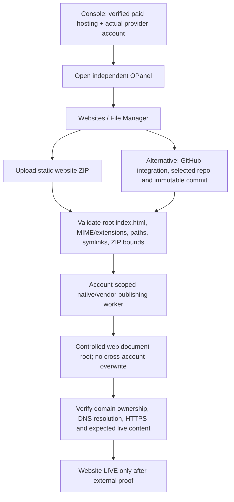

# OPanel Batch 3 + 4 — Static Website Upload, Domain Connection, Integrations and Modular Refactor
**Date:** 26 October 2026 · **Target:** independent OPanel Review PR #1 · **Release status:** code-level acceptance only, NOT Production readiness

## 1. Customer promise and actual execution boundary

Octalve customers retain **two independent website sources**: (1) manually upload a prebuilt static ZIP in OPanel Websites or File Manager; (2) later choose a GitHub repository/immutable commit as a deployment source. One does not require the other. WordPress, Cloudflare and GitHub are separate extensible integrations, not hosting platforms to which our panel depends for its identity or UI.

A customer may sign in using Console SSO (default) or the separately approved opt-in OPanel service-specific login (still gated). Both require current Console hosting proof; a hosting panel login is not a WHM/DA server password or WordPress administrator account.

### Customer flow

**Today F is implemented**, and a first-publish confined-worker routine is implemented/tested on disposable local filesystems. Real G (authorized hosting server + network dispatcher + account OS sandbox), H on a live server, I and J are not qualified.

## 2. Implemented exactly

### Static website upload and local publication

- `frontend/src/components/WebsiteUpload.tsx`: manual static ZIP picker, size limit, validation request, file manifest, cryptographic archive identifier and explicitly disabled customer Publish action. Mounted from both `Websites` and `File Manager`, independent of GitHub or WordPress. `frontend/src/app/uploads.css` isolates mobile styles; 360px horizontal overflow regression included in Playwright.
- `POST /api/websites/static/inspect/` behind `OPANEL_STATIC_UPLOAD_INSPECT_ENABLED=false` (backend authority) and `NEXT_PUBLIC_OPANEL_UPLOAD_INSPECT_ENABLED=false` (UI discoverability); same-origin rewrite and Django CSRF, current entitled account checks. Reads only an exact-size `application/zip` request and returns bounded static asset metadata with `published=false` and `deployment_enabled=false`. **It never persists an uploaded archive or touches the hosting provider.**
- `backend/bridge/static_upload.py`: bounded 8MB compressed, 32MB total unpacked, 8MB per file, 250 entries, 12 path components, max decompression ratio 100:1; rejects path traversal/absolute/backslash, case-colliding filenames, symlinks and nonregular files, executable/PHP/unknown extensions, ZIP bombs and missing root `index.html`; checks asset contents and SHA-256. Only prebuilt HTML/CSS/JS/images/fonts are eligible.
- `backend/native_agent/static_publish.py`: confined operator-only first local publication to an initially absent `public_html` from an operator-chosen account root using private staging, descriptor-relative no-follow paths, bounded assets and per-file hashes. Returns `public_http_verified=False` and refuses existing websites, wrong bound service, unsafe root or disabled writes. It is **NOT** a public upload API or approved deployed worker. Safe versioned replacements, node OS isolation, native agent enrollment and operator job ledger remain required.
- `backend/bridge/test_static_upload.py` and `test_native_static_publish.py`: tests account scope, CSRF, zip-slip, case collision, symlinks, zip bombs, no persistent upload side effects, first local publish and no overwrites.

### WordPress/Softaculous, GitHub and Cloudflare

- `backend/bridge/wordpress_plan.py` previews installation only with verified owner/provider account, PHP >=8.2, MySQL/MariaDB, explicit installer proof and operation-scoped grant. Softaculous cannot be assumed on every WHM/DA provider account.
- `backend/bridge/github_static.py` prepares **read-only GitHub App selected-repository** immutable full 40-character commit and inspected static artifact, only on plan-verified static-capable hosting. No GitHub clone, token, workflow execution or remote publish exists.
- `backend/bridge/dns_contracts.py` validates zone ID/name, live service-scoped DNS change permission, caller-proven zone control and public A/AAAA/CNAME/TXT record data/TTL. Does **not** call Cloudflare and does not imply domain registration.
- `backend/bridge/test_release_adapters.py` proves missing zone rights, cross-service grants, invalid runtime, suspicious public IP, arbitrary Git branch and unauthorized repos fail closed.
- `frontend/src/components/IntegrationHub.tsx`, `IntegrationCard.tsx`, `src/lib/integrations.ts`: modular card registry supporting future connectors. All real connections and Publish actions stay disabled.
- `DomainConnection.tsx`: domain connection overview and honest step checklist; does not invent authoritative DNS status, nameservers, SSL or registered domain state.

### Maintainable modules, not giant pages

- Old `frontend/src/components/Workspace.tsx` (~10.5KB) was refactored into a compact shell (~3.7KB), with `workspace/{WorkspaceGate,WorkspaceSidebar,HostingOverview,HostingModule,UsageMeter}.tsx` components.
- Separate `WebsiteUpload.tsx`, `DomainConnection.tsx`, `TechnicalAccessSettings.tsx`, `IntegrationHub.tsx`, `IntegrationCard.tsx`, `PlannedModuleDetail.tsx`, and the data registries in `lib/`.
- Backend SSO authority remains in `bridge/views.py`, optional password HTTP handlers moved to `bridge/technical_views.py`, static inspection HTTP to `bridge/upload_views.py`, ZIP validation/hosting-native first publish and vendor adapter contracts in distinct modules. All changes preserve existing routes and API tests.
- Styles for the new uploader are isolated in `frontend/src/app/uploads.css`, not added as a giant single component.

## 3. Exactly what is NOT yet operational

| Area | Current | External or code gap |
|---|---|---|
| Manual static archive selection | Implemented UI | Available in Review app, only validation if separately enabled |
| Static archive inspection | Implemented, gated | Browser against deployed isolated HTTPS Preview still needed |
| Local first publication | Tested on disposable filesystem | No installed native node or approved account environment |
| Replace an existing website | NOT built | Durable release generations, atomic rollback, recovery and audit |
| Live supplier document root upload | NOT built | Approved reseller/token/account-scoped provider API and egress |
| GitHub deployment | UI + immutable request contract only | GitHub App, installation/repo selection, isolated build, artifact, actual upload |
| WordPress | Installer eligibility contract only | Real Softaculous license/API or authorized PHP/SQL installer |
| Cloudflare DNS | Zone-scoped validation only | Approved zone token, binding, API and reconciliation |
| Registrar domain sale/renewal | Console quote preflight only | Real registrar sandbox, authorization, fulfillment/exception lifecycle |
| Domain DNS/SSL/HTTPS/site health | Checklist only | DNS authority and actual public site acceptance |
| Direct OPanel login | Implemented but OFF | MFA/recovery/browser/abuse gates |

No real customer upload was published, site brought online, DNS changed, domain purchased, or provider admin credential used.

## 4. Next execution gates — move to production with evidence

1. Isolate Console/OPanel databases and configure exact HTTPS Review services with branch-scoped, non-Production secrets; re-pin cross-repo CI to both exact SHAs.
2. Obtain authorized disposable DirectAdmin/WHM **provider-backed shared hosting** OR separate hardened native worker node with per-account isolation, a test-owned domain and reviewed egress. Do not allow arbitrary customer root paths or unrestricted provider API tokens.
3. Implement one source-neutral `StaticPublishAdapter` for manual ZIP and GitHub build artifact: exact service binding/Console `files.publish` capability, durable job ID, account-root isolation, file/quota/content policy, atomic versioned release, failure recovery and reconciliation.
4. Verify browser customer sign in, upload, publish, DNS resolution, HTTPS certificate and unique page body, wrong-tenant denial, replay/timeout and suspend/expire revocation. Capture redacted evidence.
5. Separately qualify GitHub App source access, Cloudflare zone mutation, WordPress installer and registrar domain commerce with actual supplier or sandbox contracts. Keep unqualified connectors disabled.
6. Only then pass the full [Console master acceptance matrix](https://github.com/octalve-core/octalve-console/blob/phase/cloud-paid-provisioning-opanel-foundation/docs/CLOUD_MASTER_ACCEPTANCE_MATRIX_2026-10-26.md), obtain owner release approval and use the protected staged Production runbook.

## 5. Published interface constraints

- No plaintext passwords, raw provider API secrets, private GitHub tokens, Cloudflare tokens or registrar EPP codes in HTML/JSON/emails.
- `files.publish`, `wordpress.install`, `dns.zone.write` and `integration.github.connect` require separately authorized operations. Console currently grants only `overview`; do NOT weaken `valid_binding` or accept caller-supplied capabilities.
- Static ZIP supports exported static websites. PHP/WordPress requires verified runtime; Next.js SSR/Node requires dedicated runtime/supervisor and must not appear as universally supported on low-tier hosting.
- Nameservers and registrar contact changes are outside OPanel's commercial ownership. OPanel can only change DNS zones under independently verified delegated authority.
- Scope, UI and tests are Review only. Keep Production and real-money/provider writes unchanged.

Official references: DirectAdmin API https://docs.directadmin.com/developer/api/ ; Cloudflare zone permissions https://developers.cloudflare.com/fundamentals/api/reference/permissions/ ; GitHub App permission model https://docs.github.com/en/apps/creating-github-apps/registering-a-github-app/choosing-permissions-for-a-github-app .
