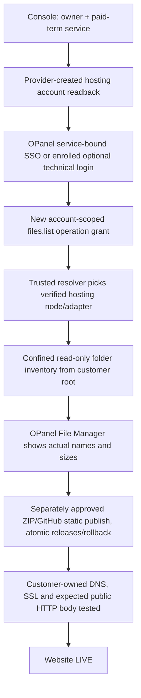

# OPanel — File Manager UI, Server Inventory and Next Release Gate
**26 October 2026 · Independent repository · PR #1 · Review only**

## Objective and delivered interface

The customer asked to see the hosting server's *actual files and folder structure in the OPanel UI*. The new File Manager at `/modules/files/` is built as a navigable workspace, not an upload-only placeholder:

- Two views: **My server files** and explicitly marked **Example preview**. Example data is never shown under the server-data mode and cannot be mistaken for an account listing.
- Left: folder tree. Center: file inventory with clickable directories, folder/file icons, type, size and unknown-modified-date indicator (we never invent timestamps). Right: selected-file details with location and provenance.
- Top: breadcrumbs, parent folder, refresh and guarded new-folder action. Bottom: link to independent manual ZIP upload under `/modules/websites/`. Manual upload is not replaced by GitHub.
- Example preview tree (NOT from any user server):
  ```text
  Home/
  ├── public_html/
  │   ├── assets/
  │   │   ├── app.js
  │   │   └── styles.css
  │   ├── images/
  │   │   └── logo.webp
  │   ├── index.html
  │   └── robots.txt
  ├── logs/
  │   └── access.log
  ├── backups/
  └── tmp/
  ```
- Filename preview, rename, delete, new-folder, ZIP publish and any unapproved writes remain disabled until actual scoped entitlement and execution are accepted.
- Layout is mobile responsive with independent `frontend/src/app/files.css`; implementation is split into `FileManager`, `FileToolbar`, `DirectoryTree`, `FileTable`, `FileDetails` and `file-types`. No thousand-line page; modularity limits remain active in CI.

## Real file inventory, fail-closed security

- `GET /api/files/list/?path=<account-relative-directory>` is wired from the same-origin Next.js frontend to `backend/bridge/files_views.py` and calls `authorize_session` before any file work. HTTP return is `503` if a verified per-account provider resolver is missing; no invented files are returned.
- `backend/bridge/file_inventory.py` validates relative paths, excludes traversal/backslashes/control characters, restricts depth/size and normalizes typed file metadata with duplicate, invalid-size or unrecognized file-type rejection. The response carries explicit `read_only`, `connected` and `source` claims.
- Native worker can already return real temporary-directory contents through a confidential HMAC-signed `NativeAdapter`, but actual account roots and adapter secrets must originate from operator-controlled infrastructure and a fresh management grant `files.list`. Console currently grants only `overview`, not `files.list`.
- `resolve_live_file_provider` deliberately always fails until securely enrolled nodes or provider-scoped file APIs and a durable trusted audit/permission resolver are connected. Never expose an absolute server path, reseller admin key or local host filesystem to the browser.
- Tests prove successful read-only inventory from a disposable real filesystem; wrong subject/binding denied; malicious names/paths/metadata blocked; unauthenticated client 401; verified session without live adapter 503; no pretend account files. Playwright tests mobile preview, folder click, details, disabled mutation and switching back to empty real server mode.

## Next end-to-end acceptance (not yet possible from CI)



Missing real dependencies: authorized DirectAdmin/WHM account or hardened native node, per-account command/API privileges, Console-issued operation scopes, distributed audit, recovery, isolated Review deployment, real browser SSO, static publish and domain/SSL/HTTP proof. Further GitHub/Cloudflare/WordPress integrations each need their own installed credentials, owner proof and technical runtime.

**Production:** No merge, Production migrations, payment, registrar order, remote file operation, email, DNS mutation or site publication was executed in this batch. Check current CI SHAs before qualifying release. Link to [Console master plan](https://github.com/octalve-core/octalve-console/blob/phase/cloud-paid-provisioning-opanel-foundation/docs/CLOUD_MASTER_EXECUTION_PLAN_2026-10-26.md) and [Batch 3/4](OPANEL_BATCH_3_4_STATIC_UPLOAD_AND_CONNECTORS_2026-10-26.md).
