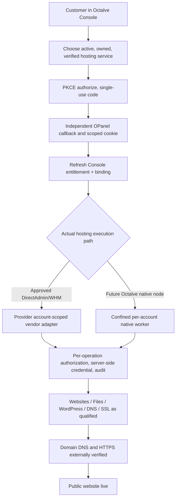

# OCTALVE OPANEL — IMPLEMENTATION HANDOFF FOR MASTER CLOUD RELEASE
**26 October 2026** | **Repository:** `octalve-core/octalve-opanel` | **Status:** Review-only, not live-qualified
**Canonical cross-product roadmap:** [Console master execution](https://github.com/octalve-core/octalve-console/blob/phase/cloud-paid-provisioning-opanel-foundation/docs/CLOUD_MASTER_EXECUTION_PLAN_2026-10-26.md)
**Acceptance matrix:** [Console master matrix](https://github.com/octalve-core/octalve-console/blob/phase/cloud-paid-provisioning-opanel-foundation/docs/CLOUD_MASTER_ACCEPTANCE_MATRIX_2026-10-26.md)
**Production procedure:** [Console release runbook](https://github.com/octalve-core/octalve-console/blob/phase/cloud-paid-provisioning-opanel-foundation/docs/CLOUD_PRODUCTION_RELEASE_RUNBOOK_2026-10-26.md)

## 0. Independent product and non-negotiable ownership

This repository owns OPanel Django backend, independently deployed Next.js frontend, database-backed Secure HttpOnly OPanel session, browser callback, per-account management authorization, provider or native technical operation adapters, audit and release.

Octalve Console **only** owns commercial customer identity/password, order, retail price/markup, payment/receipt, domain commerce, provider hosting proof, subscription and per-service technical entitlement. OPanel does not store its own customer passwords, settle invoices or take registrar payment. Its server-only account adapters must verify current Console ownership, service status and operation-specific capabilities before performing management requests.

**Current state confirmed 26 Oct:** responsive independent frontend and own SSO backend, overview, native account-worker prototype (`files.list`, `usage.read`, gated `files.mkdir`), non-public management boundary and provider read-only foundation are committed under PR #1; 3 GitHub CI workflows passed on earlier current head. Production technical operations, node enrollment, file upload, public DNS change, database provisioning and WordPress installer remain unavailable. The customer must not see those features enabled based on UI alone.

**Critical pin mismatch:** current `.github/workflows/opanel-contract.yml` pins Console commit `a594d15b8e781506553f66e9d2a53301c94d6b7f`, not the newer Console PR #14. Before release, update to the explicitly approved final Console SHA and verify cross-repository contract on disposable databases.

### Optional second *technical* OPanel login (approved 26 October)

The default remains Console → OPanel PKCE SSO. Independently, an already entitled Console customer can opt into a **service-scoped OPanel technical username/password** after SSO enrollment. Passwords are salted/hashed only in OPanel, never returned in email. A separate OPanel direct login rechecks current Console ownership/provider account proof on every session; it does **not** create a commercial billing identity, a root/WHM provider administrator, or a WordPress login. Feature is gated OFF by default until MFA, distributed throttling, recovery and HTTPS acceptance. See [dual login and integrations](OPANEL_DUAL_LOGIN_AND_INTEGRATIONS_2026-10-26.md).

The **Integrations** sidebar now has clearly disabled WordPress/Softaculous, Cloudflare and GitHub static deployment contracts. Plan/runtime capability proof, domain/zone/repository ownership and per-operation grants are required before connecting any of them. Never claim Node.js/Next.js SSR is supported by a static-only shared-hosting plan.

## 1. OPanel user flow by hosting backend

A vendor account does not equal a native OS worker. Neither branch bypasses Console's paid and provider-proven service authority. OPanel must distinguish "plan", "requested", "provider installed", and "public site verified".

## 2. Implementation work packages — ONE coordinated batch for customer hosting MVP

### OP-0 — Cross-product SSO, security and Review deploy

**Implementation**
- Re-pin Console issuer contract to exact reviewed SHA, test current v1 authorize/exchange/entitlement payload, response, expiry and origin requirements in isolated CI. No mutable "latest" version of the issuer in a security gate.
- Configure OPanel independent Review `DATABASE_URL`/`DJANGO_SECRET_KEY`, `OPANEL_PUBLIC_ORIGIN`, `OPANEL_CALLBACK_URL`, `CONSOLE_API_BASE`, `CONSOLE_WEB_ORIGIN`, confidential `OPANEL_CLIENT_ID`/`OPANEL_CLIENT_SECRET`, `OPANEL_BACKEND_ORIGIN` for Next rewrites, and correct CSRF/cookie/trusted proxy settings.
- Verify original Django fallback is not accidentally used as the branded Next.js public app; one OPanel origin with fixed same-origin rewrites and no browser API key.
- Per-request state checks: right user, active/unsuspended/nonexpired service, exact binding and provider, no stale proof, Console outage refusal, logout from locked/unlocked UI, 60s one-use PKCE callback; mobile/desktop regression.

**Accept:** actual HTTPS browser across deployed Console/OPanel, all wrong-tenant/expired/replayed access denied, no second password, 3 OPanel CI workflows green, exact paired SHAs recorded.

### OP-1 — Provider-backed safe website management

**Implementation**
- Build a clear provider-neutral **capability registry**; OPanel obtains short-lived, server-issued, operation-scoped grants from Console. Current grants only authorize `overview`. Do NOT turn on `files.upload`/`wordpress.install` with an undocumented broad toggle.
- Account adapter for read-only resource inventory, usage and server/domain metadata on exact provider service, and protected validated file list/read and upload. Credentials belong only server-side in a scoped vault and may never be put into browser JSON, SSO codes or email.
- Constrain all paths under approved document root; prohibit traversal, symlink escape, dot-dot, cross-account IDs and absolute paths; enforce upload MIME/size/quota, content security, ZIP-bomb limits, malware inspection, atomic publish, anti-replay and bounded audit records.
- Start with **static website publishing** on provider-supported shared hosting. Build a small demo page with a unique nonce, publish once and verify it through actual HTTPS on a domain under operator control. Respect provider package quota.
- For PHP/WordPress, detect verified PHP/database runtime/package first. Only install WordPress via an officially supported API/plugin on approved supplier, or an independently audited secure installer. Do NOT assume Softaculous is always present or directly callable on every vendor server; avoid plaintext WordPress admin password email. Use separate WordPress admin credentials and secure database provisioning.

**Accept:** wrong user/account cannot read/write; one site can be uploaded/served/replaced without writing outside account; one test WordPress installation if supported; correct website content, HTTPS and revoke-on-suspension; independent server evidence recorded. No website module called "live" on a vendor default page.

### OP-2 — Domain DNS and reliable customer operations

**Implementation**
- Model verified domain control/zone and service mapping; registrar NS changes stay with Console+registrar. Authoritative DNS record editing in OPanel requires separate zone-specific permission and provider support. Never conflate file-hosting ownership with registration ownership.
- Automate cert issuance, renewal, HTTPS/redirect and monitoring only on approved domain; handle name server propagation, certificate failures and mismatch.
- Service usage, backup/restore, logs and renewals need accurate vendor response timestamps and customer-friendly error states; do not fake usage figures if there is no recorded snapshot.
- Coordinate with Console to send hosting-ready and site-live emails after transactional external proof, never before. Support support escalation and audit for provisioning/WordPress/domain/DNS failures.

**Accept:** DNS resolves to correct authorized site, valid TLS certificate, the recorded HTTP body matches expected content, customer sees honest hosting/site status, notifications delivered, suspend/terminate/expiry revokes technical operations.

### OP-3 — Native Octalve hosting: expansion, NOT initial vendor path

**Implementation**
- Harden `backend/native_agent/worker.py` behind operator-approved node enrollment, mTLS/rotating key/binding, per-tenant Linux UID + mount/namespace confinement, unprivileged process execution, durable replay audit, resource and filesystem quotas, atomic uploads, identity and crash recovery.
- Build a separate agent deployment/operations service with dedicated server images, SSH/network/firewall, backup, OS patches and incident isolation.
- Enforce the same Console service-bound operation-specific grants; no fallback from unavailable provider management to wide native filesystem privileges.

**Accept:** adversarial tests on an actual disposable isolated node, no cross-tenant file/UID access, path/link traversal refused, replay on restart refused, audit surviving failure, bounded resource exhaustion and revocation. Not necessary for a **vendor-backed** initial hosting MVP.

## 3. Launch-tier contract

| Hosting tier | What the customer may expect | Availability now |
|---|---|---|
| Shared / static | Upload a prebuilt static site to owned domain, DNS+HTTPS | UI only; no actual upload |
| Shared / PHP | Supported PHP runtime, provider package, DB where provisioned | Not verified |
| Shared / WordPress | Installer + secure database + own WP admin + HTTPS | Not built |
| Managed Node/Next.js SSR | Runtime, process supervisor, deploy, env, backups and logs | **Do not advertise yet** |
| Native VM/VPS | Dedicated node isolation, lifecycle and backups | Future independent product path |
| Email inbox/SSL/DNS | Must be supported by actual account-specific vendor APIs | UI only or read-only foundation |

## 4. Release evidence — retain in Console matrix, do not duplicate truth

- Updated issuer SHA contract run + all three OPanel workflows and browser e2e test artifact ID.
- OPanel target exact commit, deployment ID, independent database identity, HTTPS origin, CSRF/session/callback tests.
- Authorized vendor account ID/host package/root + redacted proof that one account-scoped file operation succeeded and a foreign user failed.
- Unique test site domain, expected HTTP content token, DNS proof and certificate notBefore/notAfter/issuer.
- Qualified WordPress installer proof only if actually supported (do not auto-add checkmark from static website success).
- Backup/recovery, audit trail, mutation replay/manual reconciliation and kill-switch.
- Reviewer name, date and owner Production approval after all minimum-launch gates.

**Rules:** One consolidated OPanel PR; no need to migrate OPanel into Console; no independent customer password. Maintain Review flags and operator-only worker boundaries until external gates pass. Coordinate integration with the Console master plan instead of creating another divergent roadmap.